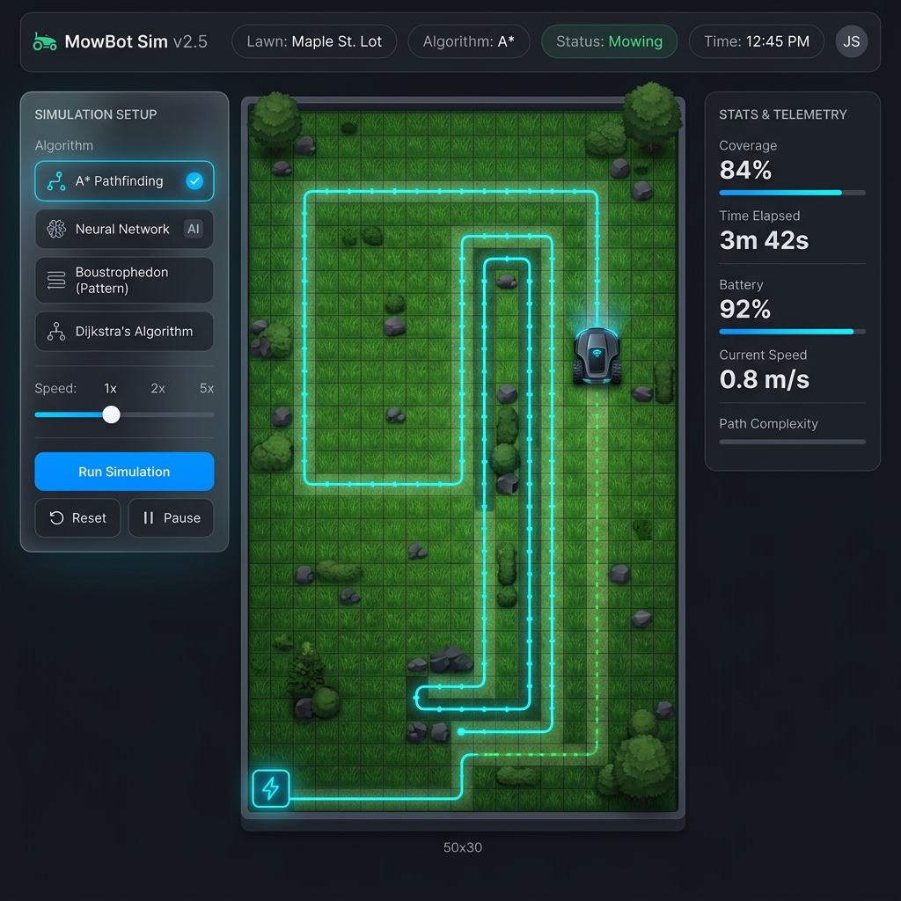

# 🚜 MowerAI: Autonomous Lawnmower Simulator

[](https://www.typescriptlang.org/)
[](https://reactjs.org/)
[](https://vitejs.dev/)
[](https://tailwindcss.com/)

**MowerAI** is a high-fidelity autonomous lawnmower simulation environment designed to test and visualize advanced pathfinding and coverage algorithms. From classic sweep patterns to evolved neural networks, MowerAI provides a robust playground for robotic navigation research and development.



---

## 🌟 Key Features

- **🤖 Autonomous Brains**: Switch between a wide array of navigation strategies, including a Genetic Algorithm-trained Neural Network.
- **⚡ Real-time Simulation**: Interactive grid environment with dynamic obstacle placement and mower state tracking.
- **🔋 Resource Management**: Realistic battery consumption logic and automated docking station return.
- **🌱 Environmental Impact**: Tracks lawn damage from excessive turning or over-mowing.
- **📊 Visual Metrics**: Heatmaps for visit counts and path visualization to analyze coverage efficiency.

---

## 🧠 Navigation Algorithms

MowerAI ships these models (the source of truth is `ALGORITHMS_LIST` in `src/constants.ts`):

### 🧩 Coverage & Sweep
- **Boustrophedon (Sweep)**: Contour pass, then back-and-forth lanes.
- **Snake Fill (DFS)**, **Energy-Conservative Sweep**, **Cell Decomposition Sweep**: Lane sweeps with different ways to pick the next lane or cell.
- **Spiral Coverage**: Square rings outwards from the start.

### 📍 Planners & Heuristics
- **Greedy (Nearest Grass)**, **A\***: Drive to the cheapest uncut grass (steps plus turns).
- **RRT Exploration**: Random tree towards the next grass.
- **Artificial Potential Fields**: Local pull to grass, push from obstacles.

### 🧬 Neural Network
- A 482-input MLP (482-32-32-4, tanh) (`src/simulation/networkPolicy.ts`). It sees only the mower's known map, turned to its heading: a 9×9 window, a coarse 35×35 view, battery, dock offset, and per move the distance to the nearest uncut grass. It chooses every move itself; only moves into a known obstacle are masked.
- Training: imitation of the best algorithm on each training lawn (DAgger), then evolution strategies (OpenAI-ES with mirrored sampling and Adam). Runs in the browser (Web Workers) or with `npm run train`.

---

## ⚖️ Network vs. algorithms: the proof

All models run under the same rules (`src/simulation/episode.ts`):

- **Unknown map**: the mower starts at the dock and only knows what its sensor (2 tiles each way) has seen. The app draws unseen tiles darker.
- **Same shared rules**: the tile being left is cut; below 20 % battery the mower drives home and charges to 80 %; when its map shows no reachable grass, it drives home.
- **One fixed score** (`src/simulation/score.ts`), set before any training: cost per reachable tile = steps + 2 × turns + overlaps + 25 × charge trips + 20 × missed tiles (+100 if not back at the dock). Lower is better.
- **Separate lawns**: generated from seeds. Training, validation (24 lawns, used to pick the best network) and test (60 lawns, only for the proof) never overlap.
- **The bar**: on each test lawn, the network must beat the *best* of all 9 algorithms on that lawn.

Run it:

```bash
npm run benchmark            # 60 test lawns, writes results/benchmark-test.md
npm run train -- --generations 200   # warm start + evolution, writes public/models/policy.json
```

In the app, **PROOF BENCHMARK** runs the same test in the browser.

### Current result (shipped model `public/models/policy.json`, 60 test lawns)

| Model | Mean cost / tile |
| --- | ---: |
| **Neural network** | **1.835** |
| Snake Fill (DFS) | 1.901 |
| Greedy (Nearest Grass) | 1.901 |
| Energy-Conservative Sweep | 1.903 |
| A* | 1.939 |
| Boustrophedon | 1.988 |
| Cell Decomposition Sweep | 1.992 |
| Potential Fields | 1.996 |
| RRT | 2.110 |
| Spiral | 2.498 |

- The network has the lowest mean cost of all models.
- Against the **best algorithm on each lawn** it is not proven yet: 22 wins, 3 ties, 35 losses (sign test p = 0.11).
- Full report: `results/benchmark-test.md`. RRT uses random numbers, so its row changes a little between runs.

### How the shipped model was trained

1. Imitation (DAgger, 4 rounds × 60 lawns) of a *rollout teacher*: at each state it tries every move, lets Greedy finish the job on the real lawn, and takes the cheapest. The teacher knows the real lawn; the network never does.
2. Evolution strategies on top. They gave little here; the best validation score is kept.

Train further: `npm run train -- --generations 200`. It continues from `training/checkpoint.json`, else from `public/models/policy.json`, and saves a model only when its validation score is better. `--fresh` starts from zero with the warm start (about 5 minutes). In the app, **START TRAINING** does the same in Web Workers.

---

## 🚀 Getting Started

### Prerequisites
- [Node.js](https://nodejs.org/) 22 (see `.nvmrc`)
- [npm](https://www.npmjs.com/)

### Installation

1. Clone the repository:
   ```bash
   git clone https://github.com/FDiskas/mowerai.git
   cd mowerai
   ```

2. Install dependencies:
   ```bash
   npm install
   ```

3. Start the development server:
   ```bash
   npm run dev
   ```

4. Open your browser to `http://localhost:3000` to see the simulator in action!

---

## 🛠️ Technical Stack

- **Core**: React 19, TypeScript
- **Styling**: Tailwind CSS 4.0
- **Build Tool**: Vite 8.0
- **AI/Logic**: Custom neural network (no ML library), imitation learning and evolution strategies, Web Workers / worker threads.

---

## 📈 Roadmap

- [ ] 3D Visualization using Three.js.
- [ ] Multi-mower swarm coordination.
- [ ] Real-world map data integration (OpenStreetMap).

---

Developed with ❤️ by [FDiskas](https://github.com/FDiskas)
